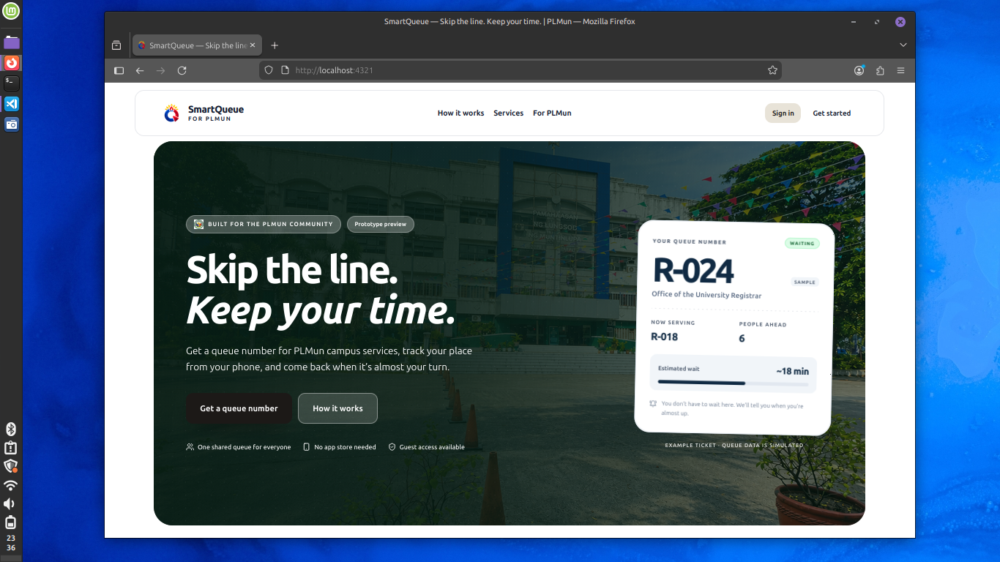
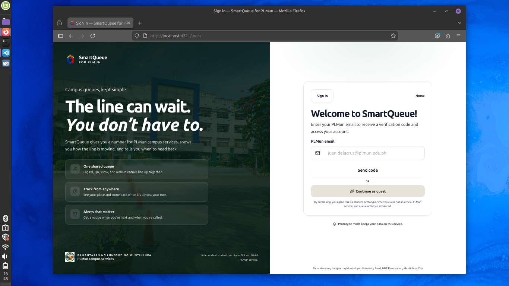
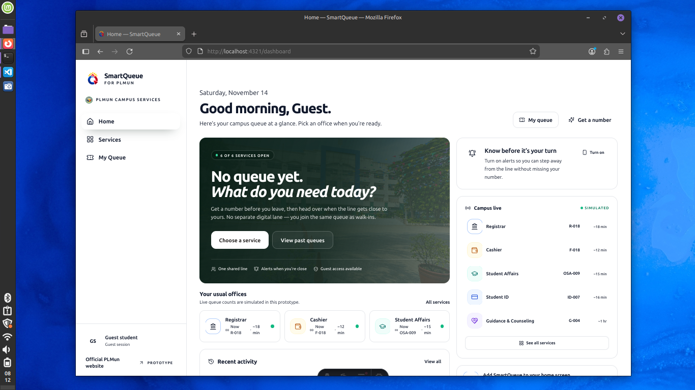
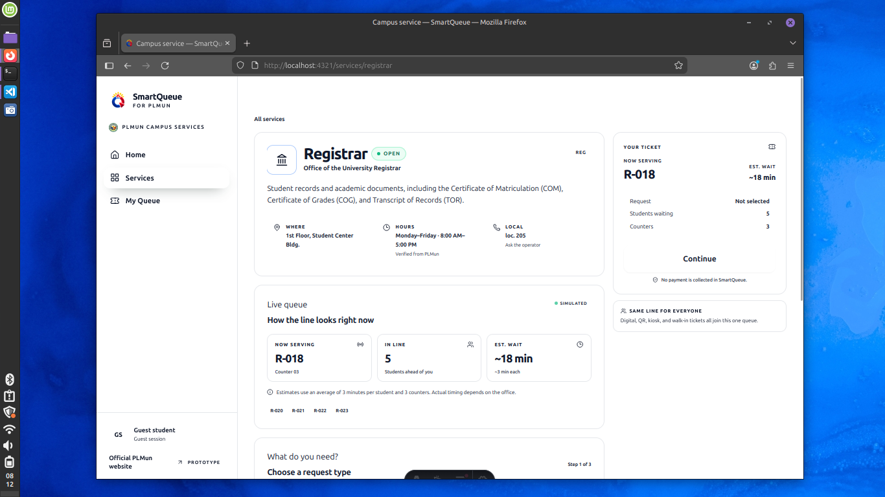

# SmartQueue for PLMun

SmartQueue is a simple queue app for Pamantasan ng Lungsod ng Muntinlupa (PLMun). It helps students skip the line and keep their time.

## What it does

- Lets students join a queue online
- Shows your place in line
- Works on phone and desktop
- Supports registrar, cashier, student affairs, and more offices

## Screenshots

Here's the flow, from opening the site to actually getting a number.

### 1. Landing page

This is the first thing you see. Big "Skip the line. Keep your time." plus a sample ticket so you already know what you're getting before you sign up.



### 2. Login

Sign in with your PLMun email and they send you a code. Don't have one yet? You can just continue as guest and try it out.



### 3. Dashboard

Your home base. It shows which offices are open, how long each line is, and a big button to get a number. No digging around.



### 4. Registrar

This is where you actually get your queue number. You see who's being served, how many people are ahead of you, and the estimated wait. Then you can just go and come back when it's almost your turn.



## How to run

1. Install dependencies
   ```
   npm install
   ```
2. Start the dev server
   ```
   npm run dev
   ```
3. Open http://localhost:4321

## Build

```
npm run build
npm run preview
```

## Tech used

- Astro
- React
- Tailwind CSS
- Neon (Postgres)

That's it. Simple.